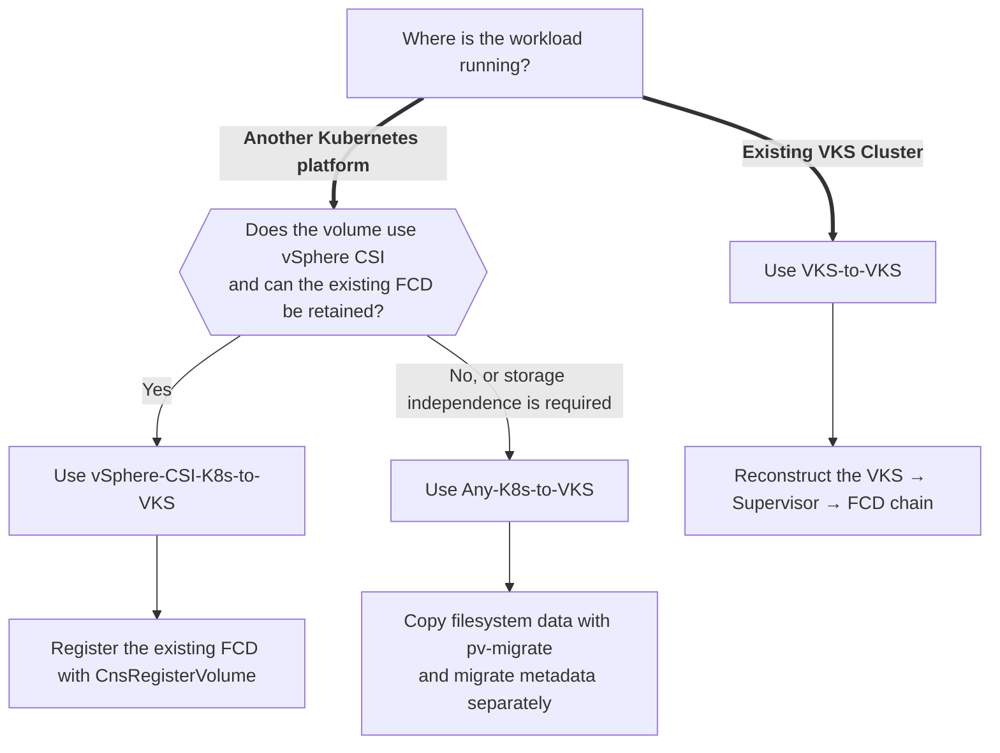
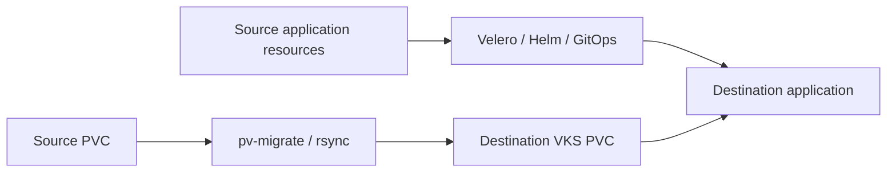
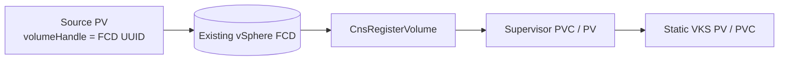
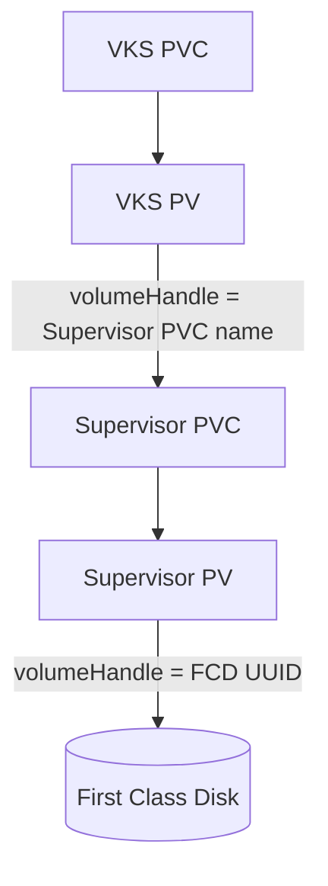

# VMware vSphere Kubernetes Service (VKS) Migrations

This directory contains migration patterns, worked examples and supporting scripts for moving stateful Kubernetes workloads to, and between, VMware vSphere Kubernetes Service (VKS) clusters.

Three approaches are provided. The correct choice depends on the source platform, its storage driver, and whether the existing vSphere First Class Disk (FCD) can be preserved.

> [!IMPORTANT]
> These examples demonstrate migration mechanisms rather than universally applicable production automation. Assess application consistency, downtime, rollback, security, and product-version compatibility for each workload.

## Choose a migration approach

| Source | Destination | Persistent-data method | Solution | Whitepaper |
|---|---|---|---|---|
| A Kubernetes cluster using the **vSphere CSI driver** | VKS | Retain the existing FCD and register it with the destination Supervisor | [`vSphere-CSI-K8s-to-VKS`](vSphere-CSI-K8s-to-VKS/) | https://www.vmware.com/docs/vmw-kubernetes-workload-migration-to-vks |
| A Kubernetes cluster running outside of vSphere | VKS | Copy the filesystem into a newly provisioned VKS PVC using `pv-migrate` | [`Any-K8s-to-VKS`](Any-K8s-to-VKS/) | https://www.vmware.com/docs/vmw-migrating-non-vsphere-kubernetes-workloads-to-vmware-vsphere-kubernetes-service-on-vmware-cloud-foundation |
| A vSphere Kubernetes Cluster | Another vSphere Kubernetes Cluster | Preserve or migrate the FCD and reconstruct the VKS/Supervisor storage chain | [`VKS-to-VKS`](VKS-to-VKS/) | https://www.vmware.com/docs/vmw-migrating-workloads-between-vmware-vsphere-kubernetes-service-clusters |

Before running an example, [obtain the required kubeconfigs](#obtain-supervisor-and-vks-kubeconfigs).

## Decision guide



## Migration approaches

### Any Kubernetes to VKS

[`Any-K8s-to-VKS`](Any-K8s-to-VKS/) is the portable filesystem-copy approach.

It separates migration into two paths:

- **Application metadata** is restored with Velero or reconstructed using Helm, GitOps, or the original deployment process.
- **Persistent data** is copied from the source PVC into a pre-created VKS PVC using `pv-migrate` and `rsync`.

Use this approach when the source and destination use different storage systems, the original disk cannot be adopted directly, or storage-platform independence is required.

The source and destination must expose compatible filesystem PVCs that can be mounted by the temporary migration pods. Raw block volumes are outside the scope of this example.



### vSphere CSI Kubernetes to VKS

[`vSphere-CSI-K8s-to-VKS`](vSphere-CSI-K8s-to-VKS/) reuses an existing vSphere CSI-backed FCD.

The source application is quiesced, the source PV is protected with a `Retain` policy, and the disk is detached. `CnsRegisterVolume` then creates the destination Supervisor PVC/PV relationship around the existing FCD. A static VKS PV/PVC exposes that Supervisor volume to the destination workload.

Use this approach when:

- The source PV uses `csi.vsphere.vmware.com`.
- The backing FCD can be retained and made available to the destination Supervisor.
- Avoiding a filesystem-level data copy is preferable.



### VKS to VKS

[`VKS-to-VKS`](VKS-to-VKS/) preserves an existing VKS volume and reconstructs its storage relationships for another VKS cluster.

A VKS PV references a Supervisor PVC. The bound Supervisor PV then references the FCD UUID:



Use this approach when migrating:

- Between VKS clusters on the same Supervisor.
- Between Supervisor namespaces.
- Between Supervisors.
- Across vCenters, with the FCD moved to the destination and registered there.

No Kubernetes- or filesystem-level data copy is performed. For a cross-vCenter migration, Storage vMotion may still transfer the FCD's storage blocks.

## Comparison

| Characteristic | Any-K8s-to-VKS | vSphere-CSI-K8s-to-VKS | VKS-to-VKS |
|---|---|---|---|
| Source requirement | Mountable filesystem PVC | vSphere CSI-backed PV | Existing VKS volume |
| Data handling | Filesystem copy | Existing FCD retained | Existing FCD retained |
| Primary storage tool | `pv-migrate` / `rsync` | `CnsRegisterVolume` | Supervisor storage reconstruction; `CnsRegisterVolume` when required |
| Application metadata | Velero, Helm, GitOps, or redeployment | Velero or redeployment | Migrated or redeployed separately |
| Storage independence | High | vSphere-specific | VKS and vSphere-specific |
| Main downtime driver | Final data synchronisation | Quiesce and disk detachment | Quiesce and storage-chain reconstruction |
| Cross-vCenter | Data is copied to destination storage | Possible when the FCD is available to the destination | FCD migration followed by destination registration |
| Best fit | Broad platform portability | Zero-copy adoption of a vSphere CSI disk | Zero-copy movement between VKS environments |

## Common migration principles

### Discover before migrating

Record the workloads, namespaces, PVCs, volume modes, access modes, StorageClasses, CSI provisioners, Helm releases, security requirements, external dependencies, and application-specific shutdown procedures.

### Treat metadata and persistent data separately

Kubernetes resources and persistent storage have different portability constraints. Do not blindly restore source PV and PVC objects into VKS. Use the selected storage workflow to prepare the destination volume, then restore or reconstruct the application around it.

### Use resource modifiers where needed

The [`Velero Configmap Modifier Examples`](velero-destination-configmap-modifier-examples.md) shows how various destination-incompatible resources can be mapped across using Velero

### Quiesce for the final cutover

A copied or preserved disk is not necessarily application-consistent. Use the application's supported shutdown, checkpoint, or backup procedure before the final storage operation.

### Validate before removing the source

At minimum, confirm:

- Destination PVCs are `Bound`.
- Workload pods are healthy.
- Application data is present and writable.
- Services and ingress are reachable.
- Authentication and external integrations work.
- Helm, GitOps, or package-manager state is healthy.
- The agreed rollback and retention period has elapsed.

## Support and validation

Before using these patterns:

1. Confirm compatibility with the source and destination Kubernetes, VKS, vCenter, and CSI versions.
2. Review third-party tools under your organisation's support and security policies.
3. Rehearse migration and rollback with representative data.
4. Confirm storage policy, networking, security, and quota requirements.
5. Retain an independent, application-consistent backup.

## Obtain Supervisor and VKS kubeconfigs

<details>
<summary>Expand setup instructions: login, export and verify kubeconfigs</summary>

The examples require **separate files with one selected context each**. A Supervisor kubeconfig accesses cluster definitions and Supervisor storage objects; a VKS kubeconfig accesses the applications inside that VKS cluster. Logging into one does not make its kubeconfig suitable for the other.

Start with the matching **step 0** for the filenames and variables used by your migration:

| Method | Access preparation |
|---|---|
| VKS → VKS | [0. Obtain kubeconfigs](VKS-to-VKS/examples/0-obtain-kubeconfigs.md) — both VKS clusters and their Supervisor(s) |
| vSphere CSI Kubernetes → VKS | [0. Obtain kubeconfigs](vSphere-CSI-K8s-to-VKS/examples/0-obtain-kubeconfigs.md) — source, destination VKS and destination Supervisor |
| Any Kubernetes → VKS | [0. Obtain kubeconfigs](Any-K8s-to-VKS/examples/0-obtain-kubeconfigs.md) — source and destination VKS |

### Before login

- Install `kubectl` plus **VCF CLI for VCF 9**, or the **vSphere Plugin for kubectl for vSphere 8**. Obtain the matching tools from your platform administrator; the vSphere plugin download page is `https://<supervisor-address>/`. Put the executables on `PATH` and verify `vcf version` or `kubectl vsphere login --help` before proceeding.
- In vSphere Client, open **Workload Management → Supervisors** (Supervisor Management in vCenter 9) and find the Supervisor's **Control Plane Node Address**. Use this address for login, including VKS login; it is not the vCenter address or a VKS node address.
- Obtain an account authorized for the hosting **Supervisor namespace** and the VKS cluster. Record that namespace and the VKS cluster name. An application namespace such as `default` inside VKS is a different namespace.
- Run from a workstation/jump host that can reach both API endpoints. Establish VPN/routing and trust the endpoint certificates first. For a lab with untrusted certificates, both login tools support `--insecure-skip-tls-verify`; this disables certificate verification.

Run the blocks individually in Bash or zsh; stop on any error. Keep exported credentials outside this repository and do not share or commit them.

```bash
umask 077
export SUPERVISOR="supervisor.example.com"  # address only, without https://
export SSO_USER="user@example.com"
export SUP_NS="team-a"                    # hosting Supervisor namespace
export VKS_CLUSTER="workload-cluster-a"
export LOGIN_KUBECONFIG="$HOME/.kube/migration-login"
mkdir -p "$HOME/.kube"
```

Use a dedicated login file so authentication does not merge migration contexts into your usual kubeconfig. Repeat the appropriate login for each Supervisor/VKS cluster, exporting the selected context before moving to the next cluster.

### VCF 9: VCF CLI

Authenticate directly to the Supervisor with a unique local context name; enter credentials when prompted:

```bash
KUBECONFIG="$LOGIN_KUBECONFIG" vcf context create migration-supervisor \
  --endpoint "https://$SUPERVISOR" --type k8s --username "$SSO_USER"

kubectl --kubeconfig="$LOGIN_KUBECONFIG" config get-contexts
```

Export the Supervisor context using the export block below. Use it to discover the exact VKS name if needed:

```bash
kubectl --kubeconfig="$OUTPUT_KUBECONFIG" \
  -n "$SUP_NS" get clusters.cluster.x-k8s.io
```

Then authenticate to the VKS cluster through that same Supervisor:

```bash
KUBECONFIG="$LOGIN_KUBECONFIG" vcf context create migration-vks \
  --endpoint "https://$SUPERVISOR" --type k8s --username "$SSO_USER" \
  --workload-cluster-namespace "$SUP_NS" \
  --workload-cluster-name "$VKS_CLUSTER"

kubectl --kubeconfig="$LOGIN_KUBECONFIG" config get-contexts
```

Export the **VKS** context this time. Generated context names vary by CLI version; copy the exact name from the listing and check its API server. For another cluster use another local name, such as `migration-vks-destination`. If the context already exists, use `vcf context refresh <context-name>` to reauthenticate, then export again from its kubeconfig. These commands use direct Supervisor authentication (`k8s`), not VCF Automation's `cci` endpoint/token flow.

### vSphere 8: kubectl vSphere plugin

Login to the Supervisor and export its context first:

```bash
KUBECONFIG="$LOGIN_KUBECONFIG" kubectl vsphere login \
  --server="$SUPERVISOR" --vsphere-username="$SSO_USER"
kubectl --kubeconfig="$LOGIN_KUBECONFIG" config get-contexts
```

Then login to VKS and export its context to a different file. The flags retain their historic `tanzu` names:

```bash
KUBECONFIG="$LOGIN_KUBECONFIG" kubectl vsphere login \
  --server="$SUPERVISOR" --vsphere-username="$SSO_USER" \
  --tanzu-kubernetes-cluster-namespace="$SUP_NS" \
  --tanzu-kubernetes-cluster-name="$VKS_CLUSTER"
kubectl --kubeconfig="$LOGIN_KUBECONFIG" config get-contexts
```

### Export and check each selected context

Set the exact context and desired output path from your method's step 0. **The output must differ from the login/input file**; shell redirection would otherwise erase the input before reading it.

```bash
export EXPORT_CONTEXT="replace-with-exact-context-name"
export OUTPUT_KUBECONFIG="$HOME/supervisor-kubeconfig" # change for each export

kubectl --kubeconfig="$LOGIN_KUBECONFIG" --context="$EXPORT_CONTEXT" \
  config view --raw --minify --flatten > "$OUTPUT_KUBECONFIG"
chmod 600 "$OUTPUT_KUBECONFIG"
kubectl --kubeconfig="$OUTPUT_KUBECONFIG" config get-contexts
kubectl --kubeconfig="$OUTPUT_KUBECONFIG" config view --minify \
  -o jsonpath='{.clusters[0].cluster.server}{"\n"}'
```

`--raw` preserves credentials, `--minify` selects only the named context, and `--flatten` embeds referenced certificate files. An `exec` authentication plugin still requires its CLI (for example `vcf`) and local login/session on the machine using the file. Exporting does not renew credentials.

Immediately after each export, run the matching API check below (`OUTPUT_KUBECONFIG` must still point to that exported file):

```bash
# Supervisor: use the hosting namespace, not a cluster-wide node query.
kubectl --kubeconfig="$OUTPUT_KUBECONFIG" --request-timeout=20s \
  get pvc -n "$SUP_NS"
# VKS: use an existing application namespace; an empty list is OK.
kubectl --kubeconfig="$OUTPUT_KUBECONFIG" --request-timeout=20s \
  get pvc -n default
```

Successful reads do not establish all migration permissions. Run the method's authorization checks before cutover. If credentials expire, repeat login/refresh **and re-export the files**. `Unauthorized` indicates an authentication problem; `Forbidden` indicates insufficient permissions. Timeouts require endpoint/routing checks; certificate errors require the correct CA trust. If the VKS context is missing, check the hosting Supervisor namespace, cluster name and account permissions.

### Export an existing source context

For a non-VKS source, first authenticate using that platform's normal procedure (for example `oc login` for OpenShift), or obtain a kubeconfig from its administrator. List its contexts, then use the same export block with `LOGIN_KUBECONFIG` pointing to that source file and `OUTPUT_KUBECONFIG` set to the source filename in step 0. Do not run a Supervisor login against a non-VKS source.

```bash
export LOGIN_KUBECONFIG="$HOME/.kube/config" # replace if source login uses another file
kubectl --kubeconfig="$LOGIN_KUBECONFIG" config get-contexts
# Now run the export block with the source context and a separate output path.
```

### Validation and references

Validation details are recorded in [the kubeconfig check](kubeconfig-validation-2026-11-12.md). The vSphere 8 flow is based on the vendor documentation and installed plugin help; it requires a vSphere 8 environment for live validation.

- [Broadcom: Supervisor/VKS login and context troubleshooting](https://knowledge.broadcom.com/external/article/435399/troubleshooting-kubectl-vsphere-contexts.html)
- [VCF CLI quick start](https://developer.broadcom.com/xapis/vcf-cli-api/latest/api-docs.html) and [Broadcom VKS solution with workload-context login examples](https://www.vmware.com/docs/isv-scality-vks-vcf)
- [Kubernetes: kubeconfig export options](https://kubernetes.io/docs/reference/generated/kubectl/kubectl-commands.html) and [Broadcom: VCF authentication executable dependency](https://knowledge.broadcom.com/external/article/408678/unable-to-run-vcf-consumption-command-li.html)

</details>
